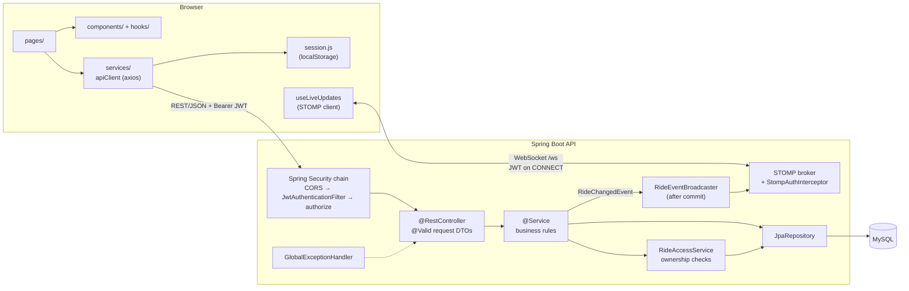
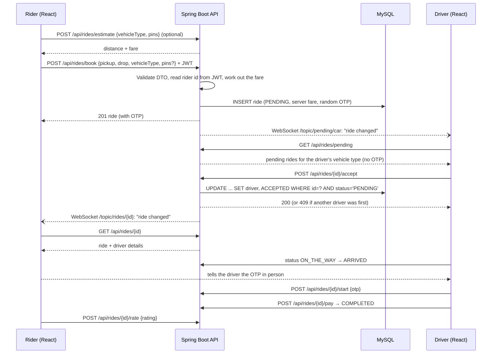
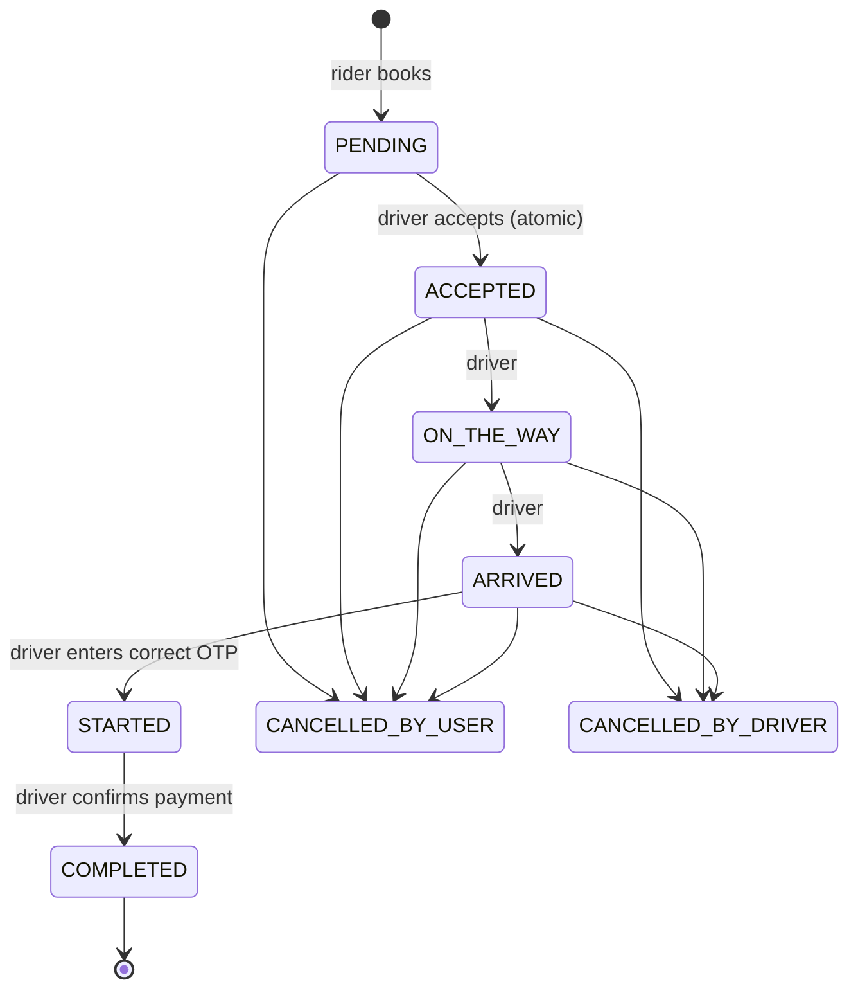
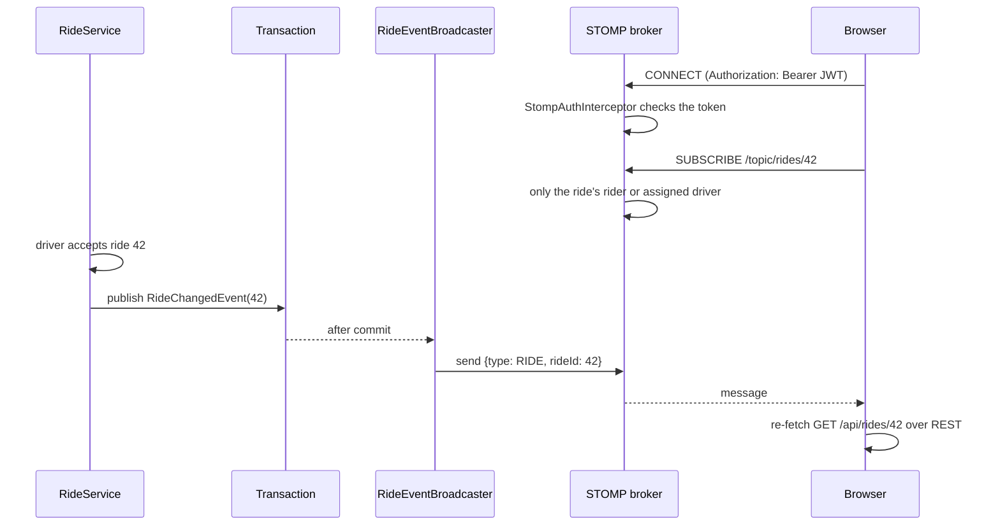
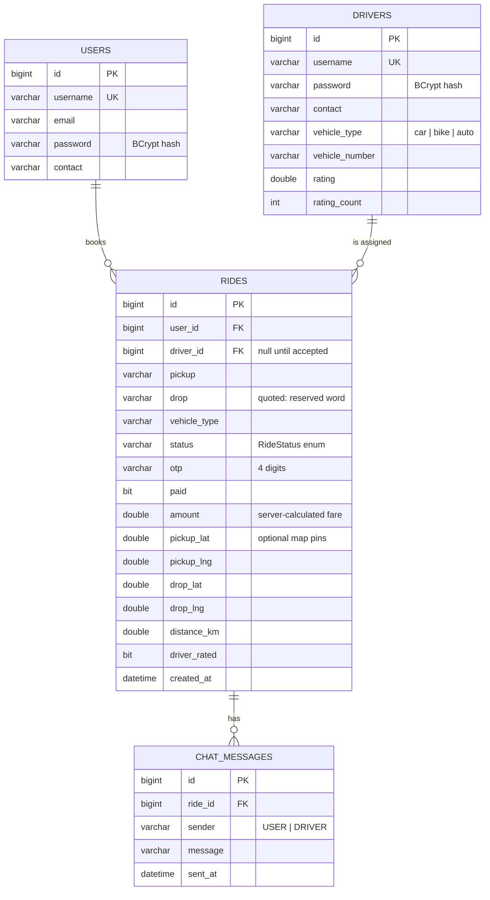
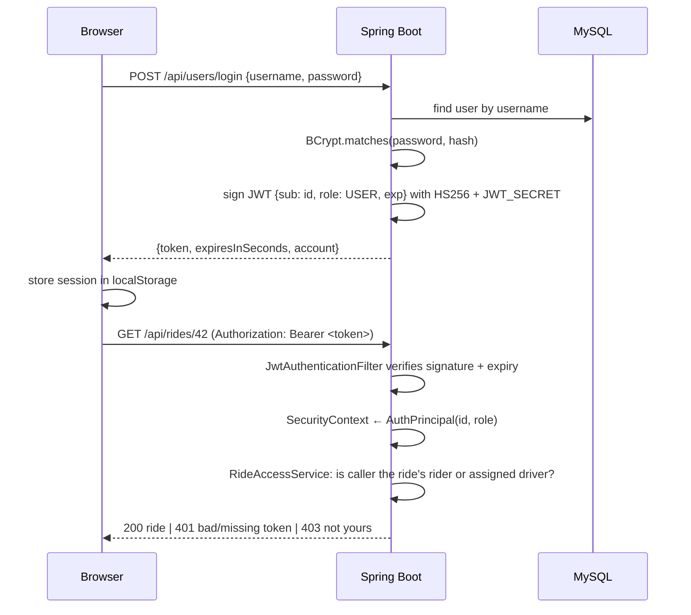

# QuickCab Architecture

Notes on how QuickCab works under the hood: how a request travels through the
app, how live updates reach the browser, how the data is stored, how login and
permissions work, and why I made the choices I did.

## 1. System Overview



| Layer | Responsibility | Never does |
|-------|----------------|-----------|
| Page / component | Rendering, local UI state, client-side validation | Build URLs or talk to axios directly |
| Frontend service | One function per API call; attaches the token | Hold UI state |
| Controller | HTTP mapping, `@Valid`, reads the caller via `@AuthenticationPrincipal` | Business logic, return entities |
| Service | Business rules, ride workflow, ownership checks, transactions | Know about HTTP |
| Repository | Database access via Spring Data JPA (parameterized queries) | String-built SQL |

## 2. Data Flow: Booking a Ride



### Ride state machine



If the WebSocket isn't connected, both screens fall back to asking every 3
seconds; while it is connected they still check every 30 seconds, just in case
a message was missed.

Every transition is checked on the server. For example, `/status` only allows
`ACCEPTED → ON_THE_WAY` and `ON_THE_WAY → ARRIVED`, and payment is only
accepted from `STARTED`.

## 3. Live Updates (WebSockets)



A few deliberate choices here:

- **Signals, not data.** The socket only says "ride 42 changed". The browser re-fetches over REST, so the existing rules (for example, only the rider sees the OTP) don't have to be duplicated for WebSockets.
- **After commit.** Events are sent from a `@TransactionalEventListener(AFTER_COMMIT)`, so when the browser re-fetches, the change is definitely in the database.
- **Auth on CONNECT.** Browsers can't set headers on the WebSocket handshake, so the token travels in the STOMP CONNECT frame. Subscriptions are checked too: `/topic/rides/{id}` only for that ride's people, `/topic/pending/{type}` only for drivers with that vehicle. Clients can't SEND anything.
- **In-memory broker.** Fine for one server. With several instances you'd plug in RabbitMQ or Redis so every instance sees every event.

## 4. Map and Fares

Riders can optionally drop a pickup and a drop pin (Leaflet + OpenStreetMap tiles).

- With both pins, `FareCalculator` works out the straight-line (haversine) distance and charges `base + perKm × km`, but never less than the vehicle's minimum. Without pins, the minimum applies, which is exactly the old flat fare, so older clients and rides keep working.
- `POST /api/rides/estimate` lets the booking screen show the price before you commit. The booking itself recalculates on the server; the estimate is just for display.
- Distances over 300 km are rejected as mis-placed pins.
- The map code is lazy-loaded, so Leaflet only downloads on screens that show a map.

Known limitation: the straight line is shorter than the real road, so fares come out slightly low. A routing API (OSRM, Google Directions) would fix that.

## 5. Database

Tables are created by Hibernate (`ddl-auto=update`). Relationships are by id
columns (no JPA associations), which keeps entities simple and avoids lazy-loading
surprises when they are mapped to DTOs.



Indexes: `rides(user_id)`, `rides(driver_id)`, `rides(status, vehicle_type)` and
`chat_messages(ride_id)`, which are exactly the columns the app filters on.

Riders and drivers are separate tables, so an id alone is ambiguous. That is why
the JWT always carries both the id and the role.

## 6. Authentication and Authorization (JWT)



**Authentication** (who are you?)
- Passwords are hashed with BCrypt. Accounts created before hashing are upgraded on their next successful login.
- Login returns a signed JWT: subject = account id, claim `role` = `USER` or `DRIVER`, expiry = `JWT_EXPIRATION_MINUTES`.
- The signing key comes from `JWT_SECRET`. The app refuses to start without it or if it is shorter than 32 bytes.
- `JwtAuthenticationFilter` validates the token on each request. An invalid token simply leaves the request anonymous, and `SecurityConfig` then returns 401 for anything except register and login.

**Authorization** (what may you do?)
- The caller's identity is **only** taken from the token. Endpoints use `/me`, `/mine`, `/pending` instead of accepting account ids, and body fields such as `userId`, `sender` or `by` are ignored.
- `RideAccessService` is the single place that decides who may touch a ride: `getForRider`, `getForAssignedDriver` and `getForParticipant`.
- Responses are role-aware: the OTP is only returned to the rider.

**Brute-force protection**
- After 5 wrong passwords for an account, logins for it are refused (429) for 15 minutes.
- After 5 wrong OTPs for a ride, starting it is refused for 15 minutes. A 4-digit OTP has only 9000 possible values, so without this it could be guessed.
- `AttemptLimiter` keeps the counts in memory. With several servers it would move to Redis. Keying on the username means someone could temporarily lock a user out on purpose; adding the client IP is the usual fix.

**Frontend side**
- `apiClient` adds `Authorization: Bearer …` to every request. On a 401 it clears the session and redirects to the login page.
- `RequireAuth` guards routes for a better UX. It is not the security boundary; the API is.
- Logout deletes the token locally. Tokens are stateless and expire on their own.

## 7. Error Handling

All errors use one JSON shape:

```json
{ "status": 400, "error": "Enter a valid email address", "fieldErrors": { "email": "Enter a valid email address" } }
```

- Services throw `ApiException` (400/401/403/404/409) with a user-safe message.
- `GlobalExceptionHandler` (`@RestControllerAdvice`) maps those, validation errors, Spring MVC errors and anything unexpected. Unexpected errors are logged on the server and returned as a generic 500.
- The security layer writes the same shape for 401/403.
- The frontend's `getErrorMessage` only displays short, plain messages from this shape and falls back to a friendly default otherwise. An `ErrorBoundary` catches rendering crashes.

## 8. Running It (Docker)

`docker compose up --build` starts three containers: MySQL (not exposed to the host),
the API (built with the Maven wrapper, running as a non-root user) and an nginx
container serving the React build with SPA routing and basic security headers.
CI builds both images on every push.

## 9. Key Design Decisions

| Decision | Why | Trade-off |
|----------|-----|-----------|
| **Stateless JWT** instead of server sessions | No session store; any API instance can serve any request (easy horizontal scaling); simple for a SPA | Tokens can't be revoked before expiry; mitigated by a short-ish expiry |
| **Token in `localStorage`** | Simple and works across tabs; no cookies means no CSRF | Readable by injected scripts if an XSS bug existed; React escapes output and there is no `dangerouslySetInnerHTML`. httpOnly cookies are a future improvement |
| **Identity from token, not from URLs** | Removes the whole class of "change the id in the URL" (IDOR) bugs | Endpoints are less generic (`/me`, `/mine`) |
| **Central `RideAccessService`** | One place to review and test ownership rules | Services depend on it |
| **DTOs (Java records)** for requests and responses | Validation lives on the request; responses can't leak fields like passwords; API is decoupled from the schema | Some mapping code |
| **Atomic conditional UPDATE** to accept rides | Two drivers clicking Accept at once can't both win, without locks or version columns | A custom JPQL query |
| **Enums stored as strings** | Readable data; existing rows stayed compatible when the code moved from strings to enums | Renaming a constant needs a data migration |
| **WebSockets for signals + polling as a fallback** | Instant updates with far fewer requests; still works if the socket is blocked | Two code paths to keep in mind |
| **Events sent after commit** | Clients never re-fetch stale data | Needs a transactional event listener rather than sending straight from the service |
| **Straight-line fares** | No paid routing API, works offline in tests | Undercharges a little versus real road distance |
| **In-memory rate limiting** | Zero extra infrastructure | Resets on restart; per-instance only |
| **Server-side fare and OTP** | Clients can't choose their price; OTP comes from `SecureRandom` | Flat fares only for now |
| **Frontend services layer + hooks** | Pages stay declarative; API changes touch one file; logic is unit-testable | A few more files |
| **H2 for the integration test** | The full Spring context and every rule are tested in CI without a database server | H2 is not MySQL; Testcontainers would be closer to production |
