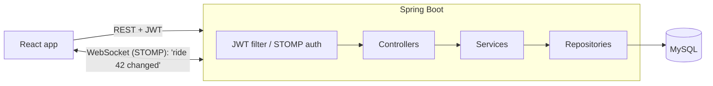

# QuickCab

[](https://github.com/chatura-bhavishya/QuickCab/actions/workflows/ci.yml)

A cab booking app where riders book a car, bike or auto, watch the driver come to them live, and start the trip with a one-time PIN.

Built with React and Spring Boot. I started it as a simple CRUD project and kept pushing it until it behaved like something you could actually run: real authentication, people only seeing their own data, live updates, a map with distance-based fares, and a test suite that runs on every push.

## Why I built it

Booking a local ride often means calling a driver, agreeing on a price, and hoping the person who shows up is the one you spoke to. I wanted to see what it takes to solve those three problems properly:

- **Fair price up front.** The server calculates the fare from the distance between your pins. The browser never gets to choose the price.
- **Know what's happening.** The rider sees every step (accepted, on the way, arrived) the moment the driver taps it.
- **Right driver, right rider.** The rider gets a 4-digit OTP and tells it to the driver in person. The ride can't start without it, and the driver's app never receives it.

## What it does

**As a rider**
- Sign up, log in, edit or delete your profile
- Book a ride: type the addresses, or drop pins on the map to get a distance-based price before you book
- Follow the ride live, see the driver's details and the route on a map
- Chat with your driver, cancel before the trip starts, rate the driver afterwards (once)

**As a driver**
- See new requests for your vehicle type the moment they come in
- Accept a ride (if two drivers tap at once, only one gets it)
- Mark yourself on the way and arrived, start the trip with the rider's OTP, confirm payment
- Chat with the rider and see your ride history

## Screenshots

<!-- Replace these with fresh screenshots: booking with the map, ride status, driver dashboard. -->

| | | |
|---|---|---|
|  |  |  |

## Tech stack

| | |
|---|---|
| **Frontend** | React 18, React Router, Axios, Leaflet + OpenStreetMap, STOMP.js, Vite |
| **Backend** | Java 17, Spring Boot 3 (Web, Security, Data JPA, Validation, WebSocket), JJWT |
| **Database** | MySQL 8 (H2 for tests) |
| **Testing** | JUnit 5, Mockito, MockMvc, Vitest, React Testing Library |
| **Tooling** | Docker Compose, GitHub Actions, Maven Wrapper, ESLint |

## How it fits together



The short version:

- Every request carries a JWT. The server reads **who you are from the token**, never from an id in the URL, and a single class (`RideAccessService`) decides whether you're allowed to touch a given ride.
- When something changes, the server pushes a tiny "ride 42 changed" message over a WebSocket. The browser then re-fetches through the normal API, so the permission rules apply there too. If the socket drops, the app quietly falls back to polling.
- Wrong passwords and wrong OTPs are rate-limited, so a 4-digit code can't simply be brute-forced.

There's more detail (the auth flow, the ride state machine, the database tables, and why I made each trade-off) in **[ARCHITECTURE.md](ARCHITECTURE.md)**.

## Project layout

```
QuickCab/
├── src/                      React app
│   ├── pages/                one component per screen
│   ├── components/           shared UI (LoginForm, ChatPanel, map/, driver/, ride/, forms/)
│   ├── hooks/                usePolling, useLiveUpdates, useFareEstimate, useForm
│   ├── services/             all API + WebSocket calls, session storage
│   ├── constants/  utils/
├── backend/                  Spring Boot API
│   └── src/main/java/com/application/cabapp/
│       ├── controller/  service/  repository/  model/  dto/
│       ├── security/         JWT, password hashing, rate limiting
│       ├── realtime/         WebSocket events and auth
│       ├── config/  exception/  validation/
├── docker-compose.yml        MySQL + API + web in one command
└── .github/workflows/ci.yml
```

## Running it

### The quick way (Docker)

```bash
cp .env.example .env     # set MYSQL_ROOT_PASSWORD and JWT_SECRET
docker compose up --build
```

Then open http://localhost:3000. The API is on http://localhost:8080.

### Without Docker

You'll need Node 20+, Java 17+ and a local MySQL 8. Maven isn't needed because the wrapper downloads it.

```bash
# 1. API
cd backend
cp .env.example .env     # set DB_PASSWORD and JWT_SECRET
./mvnw spring-boot:run   # Windows: mvnw.cmd spring-boot:run

# 2. Frontend (in another terminal, from the project root)
npm install
npm run dev              # http://localhost:5173
```

The database and tables are created on first start.

## Configuration

Copy the example files. The real `.env` files are git-ignored.

**API** (`backend/.env`, see [`backend/.env.example`](backend/.env.example))

| Variable | Needed? | What it is | Default |
|---|---|---|---|
| `DB_PASSWORD` | yes | MySQL password | none |
| `JWT_SECRET` | yes | Secret for signing login tokens, 32+ characters (`openssl rand -base64 48`) | none |
| `DB_URL` / `DB_USERNAME` | no | Where the database is | local `cabdb` / `root` |
| `JWT_EXPIRATION_MINUTES` | no | How long a login lasts | `1440` |
| `CORS_ALLOWED_ORIGINS` | no | The frontend's address | `http://localhost:5173` |
| `LOGIN_MAX_FAILURES` / `LOGIN_LOCK_MINUTES` | no | Brute-force protection | `5` / `15` |
| `PORT`, `SHOW_SQL` | no | API port, SQL logging | `8080`, `false` |

**Frontend** (`.env`, see [`.env.example`](.env.example))

| Variable | What it is | Default |
|---|---|---|
| `VITE_API_BASE_URL` | Where the API lives | `http://localhost:8080/api` |
| `VITE_WS_URL` | WebSocket address, if it's somewhere unusual | worked out from the API URL |

## Tests

```bash
cd backend && ./mvnw test   # 61 tests, including a full ride on H2 and a real WebSocket connection
npm test                    # 45 frontend tests (Vitest + React Testing Library)
npm run lint
```

GitHub Actions runs all of that, plus both production builds and the Docker images, on every push.

The two tests I'd point to first:
- `RideFlowIntegrationTest` books and completes a ride with two riders and two drivers, and checks at every step that nobody can see or change what isn't theirs.
- `LiveUpdatesIntegrationTest` opens real WebSocket connections and checks that the rider hears about the driver accepting, while a stranger is refused.

## API

The endpoint list is in [backend/README.md](backend/README.md).

## What I'd do next

- Use a routing service for real road distance; the fare currently uses the straight line between the pins
- Show the driver's live location on the rider's map
- Move the login token to an httpOnly cookie with refresh tokens
- Use Flyway migrations instead of letting Hibernate manage the schema
- Run the integration tests against real MySQL with Testcontainers
- Add real payments instead of the driver confirming cash
- Deploy it somewhere public with a demo account

## What I learned

- **Security is mostly about where you get identity from.** The first version trusted ids sent by the browser, so anyone could edit anyone's profile. Taking identity only from the token removed that whole class of bug.
- **Race conditions show up in simple places.** Two drivers accepting the same ride is a real problem. A conditional `UPDATE ... WHERE status = 'PENDING'` solved it without any locking.
- **Push the signal, not the data.** Sending only "ride 42 changed" over the socket meant I didn't have to re-implement the permission rules for WebSockets.
- **Tests change how you refactor.** Once the end-to-end test existed, I could restructure the code without being scared of breaking it.
