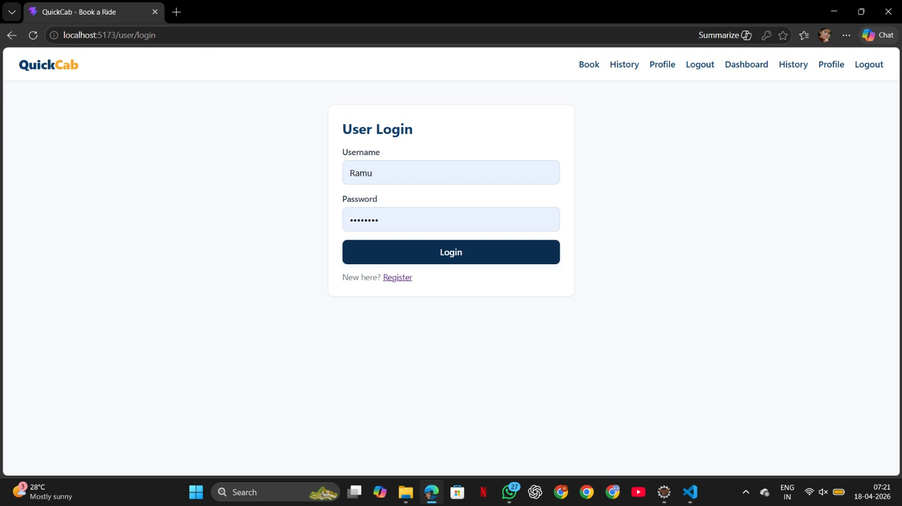
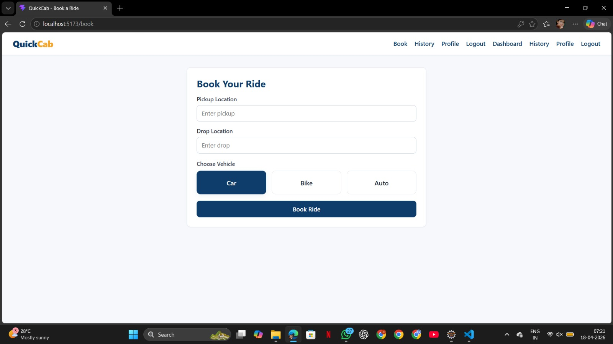
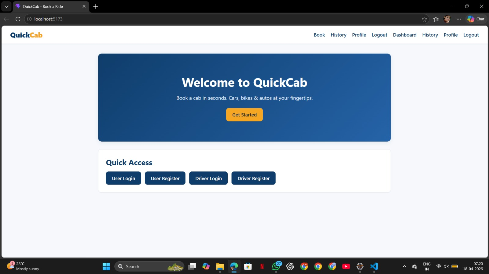
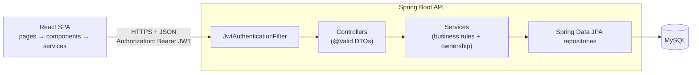

# QuickCab

[](https://github.com/chatura-bhavishya/QuickCab/actions/workflows/ci.yml)

**A full-stack, secure cab booking app: riders book a car, bike or auto, and drivers pick up, verify and complete the trip in real time.**

## The Problem

Booking a local ride often means phone calls, haggling over the fare and no
way to know whether the driver who turns up is the one you booked. QuickCab
puts the whole trip in one place:

- the fare is fixed up front by the server,
- the rider sees every step of the ride live,
- a one-time PIN (OTP) proves the right driver picked up the right rider,
- and rider and driver can message each other without sharing phone numbers.

## Features

**Riders**
- Register, log in, and edit or delete their profile
- Book a ride with pickup/drop autocomplete from past trips
- Choose Car, Bike or Auto with a fixed, server-calculated fare
- Track the ride live: `PENDING → ACCEPTED → ON_THE_WAY → ARRIVED → STARTED → COMPLETED`
- Share an OTP with the driver to start the ride
- Chat with the assigned driver, cancel before the ride starts, rate the driver once

**Drivers**
- See pending requests for their own vehicle type and accept or deny them
- Move the ride through each stage, start it with the rider's OTP, confirm payment
- Chat with the rider, cancel before pickup, view their ride history

**Security and quality**
- JWT authentication (Spring Security, stateless) with BCrypt-hashed passwords
- Ownership checks on every endpoint: people can only see and change their own data
- Bean Validation on every request plus matching client-side validation
- Consistent JSON errors with no stack traces; CORS limited to the frontend origin
- 79 automated tests (JUnit 5, Mockito, MockMvc, H2, Vitest, React Testing Library) run in GitHub Actions

## Screenshots

<!-- Add or replace screenshots here (e.g. booking screen, ride status, driver dashboard). -->

| | | |
|---|---|---|
|  |  |  |

## Tech Stack

| Layer | Technology |
|-------|------------|
| Frontend | React 18, React Router 6, Axios, Vite 5, plain CSS |
| Backend | Java 17, Spring Boot 3.3 (Web, Data JPA, Security, Validation), JJWT |
| Database | MySQL 8 (H2 in tests) |
| Testing | JUnit 5, Mockito, Spring MockMvc, Vitest, React Testing Library |
| Tooling | Maven Wrapper, ESLint 9, GitHub Actions |

## Architecture Overview



- The **frontend** keeps all HTTP calls in `src/services`, attaches the JWT to every request, and polls ride status and chat every 3 seconds.
- The **backend** is layered: controller → service → repository. Controllers only accept and return DTOs. Services take the caller from the token and enforce who may do what.

See [ARCHITECTURE.md](ARCHITECTURE.md) for data flow, database tables, the JWT flow and design decisions.

## Folder Structure

```
QuickCab/
├── src/                          # React frontend
│   ├── components/               # Reusable UI (LoginForm, ChatPanel, ErrorBoundary, ...)
│   │   ├── driver/  ride/  forms/
│   ├── pages/                    # One component per route
│   ├── hooks/                    # usePolling, useForm
│   ├── services/                 # API client, auth/session, ride/chat/account calls
│   ├── constants/                # Statuses, vehicles, limits, storage keys
│   ├── utils/                    # Validation, error messages, keyboard helpers
│   └── test/setup.js             # Vitest setup
├── backend/                      # Spring Boot API
│   ├── mvnw, mvnw.cmd, pom.xml
│   └── src/main/java/com/application/cabapp/
│       ├── config/               # SecurityConfig (JWT, CORS)
│       ├── controller/           # REST endpoints
│       ├── service/              # Business logic + RideAccessService (ownership)
│       ├── repository/           # Spring Data JPA
│       ├── model/                # JPA entities and enums
│       ├── dto/request|response/ # API contracts (validated requests, safe responses)
│       ├── security/             # JwtService, filter, PasswordService
│       ├── exception/            # ApiException + global handler
│       └── validation/           # Shared validation rules
├── .github/workflows/ci.yml      # CI pipeline
├── ARCHITECTURE.md
└── screenshots/
```

## Running Locally

### Prerequisites
- Node.js 20+ and npm
- Java 17+ (Maven is **not** required; the wrapper downloads it)
- MySQL 8 running locally

### 1. Backend

```bash
cd backend
cp .env.example .env          # then set DB_PASSWORD and JWT_SECRET
./mvnw spring-boot:run        # Windows: mvnw.cmd spring-boot:run
```

The API starts on `http://localhost:8080`. The `cabdb` database and tables are created automatically.
Run the command from inside `backend/` so `backend/.env` is picked up, or set the variables in your shell/IDE.

### 2. Frontend

```bash
# from the project root
cp .env.example .env          # optional; defaults to http://localhost:8080/api
npm install
npm run dev
```

Open `http://localhost:5173`.

## Environment Variables

Real `.env` files are git-ignored; copy the templates.

**Backend** ([`backend/.env.example`](backend/.env.example))

| Variable | Required | Description | Default |
|----------|----------|-------------|---------|
| `DB_PASSWORD` | yes | MySQL password | - |
| `JWT_SECRET` | yes | Token signing secret, at least 32 characters (`openssl rand -base64 48`) | - |
| `DB_URL` | no | JDBC URL | `jdbc:mysql://localhost:3306/cabdb?...` |
| `DB_USERNAME` | no | MySQL user | `root` |
| `JWT_EXPIRATION_MINUTES` | no | How long a login lasts | `1440` (24 h) |
| `CORS_ALLOWED_ORIGINS` | no | Exact frontend origin(s), comma-separated | `http://localhost:5173` |
| `PORT` | no | API port | `8080` |
| `SHOW_SQL` | no | Log SQL for debugging | `false` |

**Frontend** ([`.env.example`](.env.example))

| Variable | Description | Default |
|----------|-------------|---------|
| `VITE_API_BASE_URL` | Base URL of the API | `http://localhost:8080/api` |

## Running Tests

```bash
# Backend: unit, web-layer (security) and H2 end-to-end tests
cd backend && ./mvnw test

# Frontend: Vitest + React Testing Library
npm test            # single run
npm run test:watch  # watch mode
npm run lint
```

CI runs all of these plus both production builds on every push and pull request.

## API

The endpoint reference is in [backend/README.md](backend/README.md).

## Future Improvements

- **Real-time updates** with WebSockets/STOMP instead of 3-second polling
- **httpOnly refresh-token cookies** instead of keeping the access token in `localStorage`
- **Rate limiting** on login and OTP attempts (e.g. Bucket4j) and account lockout
- **Flyway migrations** instead of `ddl-auto=update`, plus foreign keys and indexes
- **Maps and live location** (pickup pins, ETA, distance-based fares)
- **Payments** through a gateway instead of the driver confirming cash
- **Driver matching** by distance instead of a first-come list
- **Docker Compose** for one-command local setup, and deployment to a cloud host
